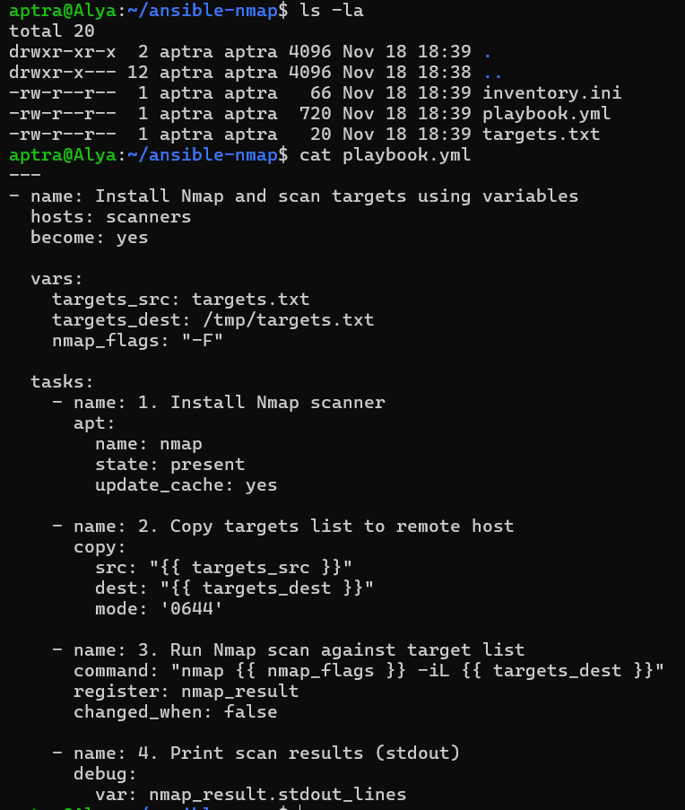
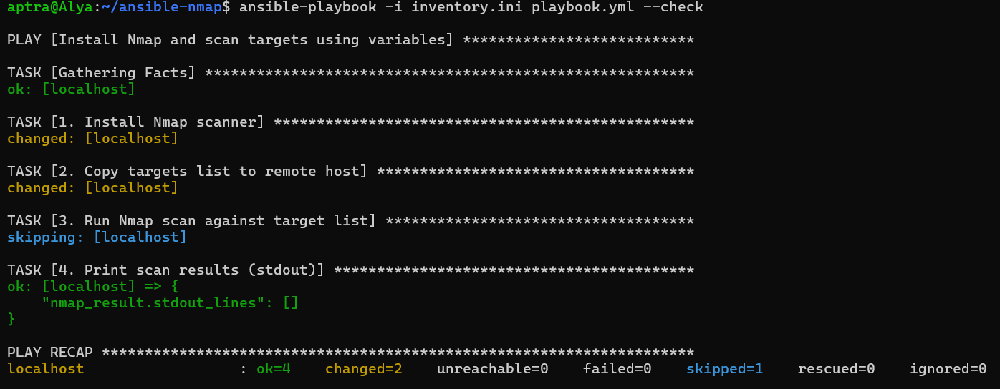
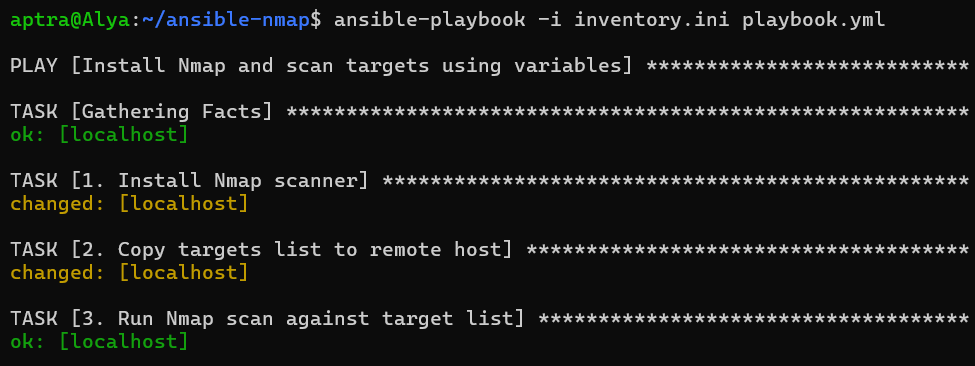
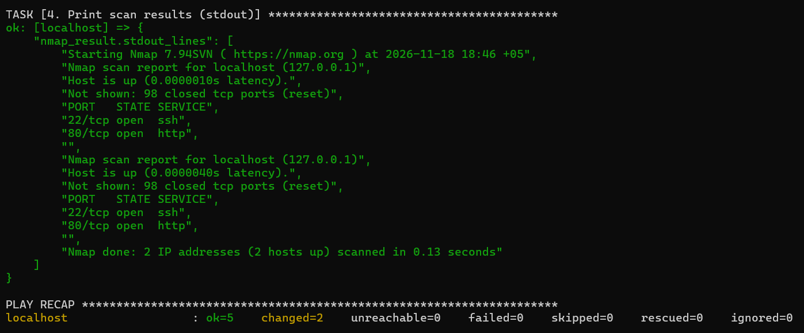

# Лабораторная работа П05: Работа с переменными в Ansible (WSL)

**Выполнила:** Аптракова Альфия, студентка группы ИТ-1-2024 

---

## Цель работы

Освоить использование переменных в Ansible (`vars` для параметризации путей и флагов команд, а также `register` для перехвата и вывода `stdout`) на примере автоматизированной установки и запуска сетевого сканера Nmap[cite: 12].

---

## Что сделано

1. Использовано подготовленное окружение WSL (Ubuntu) с пользователем `runner`, правами `sudo` без пароля и настроенным SSH-доступом.
2. Подготовлен файл инвентаря (`inventory.ini`) и файл со списком целевых хостов (`targets.txt`).
3. Разработан плейбук `playbook.yml`, использующий блок переменных `vars` (пути к файлам и аргументы запуска) и директиву `register` (сохранение результата сканирования).
4. Плейбук автоматически устанавливает пакет `nmap`, копирует список целей на целевой узел, запускает сканирование и выводит собранный `stdout` через модуль `debug`[cite: 12].
5. Проведена проверка синтаксиса (`--syntax-check`), тестовый (`--check`) и боевой запуски плейбука.

---

## Структура проекта

- `playbook.yml` — основной Ansible-плейбук с использованием переменных `vars` и `register`.
- `inventory.ini` — файл инвентаря для подключения к локальному хосту.
- `targets.txt` — список целей для сканирования утилитой Nmap.
- `screenshots/` — скриншоты этапов выполнения и вывода результатов.

---

## Скриншоты выполнения

- **Файлы проекта и структура плейбука с переменными:**
  

- **Проверка синтаксиса и тестовый запуск (`--check`):**
  

- **Боевой запуск плейбука (установка Nmap и копирование целей):**
  

- **Вывод результатов сканирования (`stdout`) и `PLAY RECAP`:**
  

---

## Вывод

В ходе выполнения лабораторной работы были изучены механизмы объявления и подстановки переменных (`{{ var_name }}`) в Ansible, а также перехват стандартного вывода команд (`stdout_lines`) с помощью `register` и `debug`. Это позволило сделать плейбук универсальным и гибким без жесткой привязки к именам файлов и параметрам сканирования.
